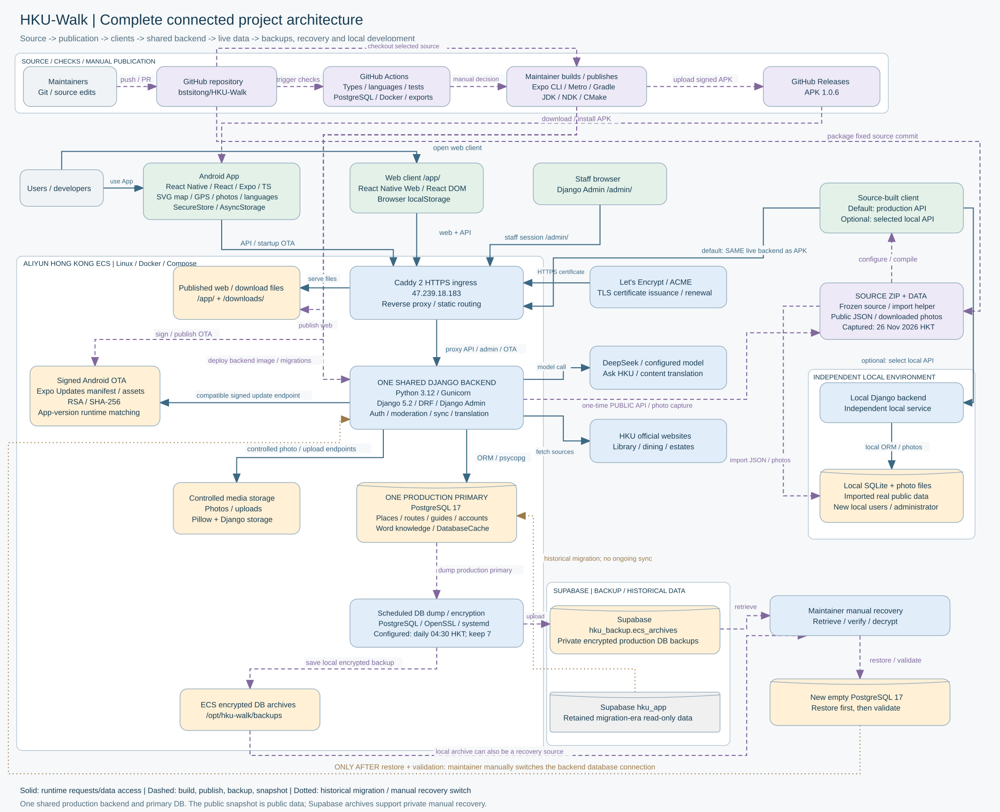

# HKU-Walk

A campus map and student guide for University of Hong Kong students and visitors.
HKU-Walk brings together place search, illustrated walking directions, student
guides, campus Q&A and reviewed community contributions.

**[Download Android 1.0.6](https://github.com/bstsitong/HKU-Walk/releases/download/v1.0.6/HKU-Walk-1.0.6.apk)** · [Open the web app](https://47.239.18.183/app/) · [Source code](https://github.com/bstsitong/HKU-Walk) · [Chinese README](README.zh-CN.md)

## Features

| Feature | What it does |
| --- | --- |
| Campus map | Browse places and facilities, zoom the SVG map, inspect photos, entrances and floor information, and show foreground device location |
| Place search | Search names, room codes, English abbreviations, Simplified/Traditional Chinese, pinyin, aliases and approximate spellings |
| Walking directions | Select endpoints and view published routes, ordered instructions, overview images and enlarged step photos |
| Student guides | Read arrival information, useful links, food recommendations and group information, with article search, Markdown and photos |
| Ask HKU | Ask questions using published campus records, reference documents and public HKU webpages, with source references |
| Accounts and profiles | Register, sign in, edit profiles, avatars and cover photos, manage passwords, recovery codes and author visibility |
| Bookmarks and history | Keep account-specific records with local caching, queued changes and backend synchronization |
| Contributions | Submit places, illustrated routes, guides and corrections; revise requests and publish after moderation |
| Discussions and inbox | Comment, reply and react to published content, and read review/comment notifications |
| Three languages | English, Simplified Chinese and Hong Kong Traditional Chinese in the App and administration interface |

Map, guide and published discussion browsing is public. Contributions and personal
features require an App account. Routes are retrieved from published records; a
missing route is shown as awaiting content. Device positioning and route diagrams
do not establish indoor positioning or surveyed turn-by-turn navigation.

## Install and use

Download the APK, allow installation from the browser or file manager when Android
asks, and open the App with an Internet connection. Allow its signed startup update
to finish. Browse without signing in, or create an account for personal features.
The standalone APK runs without Expo Go or a development computer.

| Android release | Value |
| --- | --- |
| Version / version code | 1.0.6 / 10 |
| Application ID | `com.hkuwalk` |
| Supported architectures | ARM64 phones and x86_64 emulators |
| Minimum Android version | Android 7.0 / API 24 |
| File size | 45,651,901 bytes |
| Release | [v1.0.6](https://github.com/bstsitong/HKU-Walk/releases/tag/v1.0.6) |

APK SHA-256:

```text
1902493d37d1e521f2d372ed4b0c02ad421d66a12d7a0e67e85f347ac56f4911
```

The [web app](https://47.239.18.183/app/) uses the same hosted API. It is an
additional browser deployment; its later compatibility changes are not all present
in every source snapshot. Native iOS builds require macOS/Xcode and separate device
validation; the downloadable native release here is Android.

## Architecture and technology stack



[Full-size diagram](architecture/architecture-en.svg) · [Editable Mermaid topology](architecture/architecture-en.mmd) · [Detailed technology inventory](TECHNOLOGY.md)

The user clients and staff browser reach Caddy over HTTPS. Caddy routes API and
administration requests to the same Django backend, which reads and updates the
production PostgreSQL database according to permissions. It also serves published
web/download files. Model calls, media access, backups and publication paths are
connected to their actual services in the diagram.

| Layer | Technologies and responsibilities |
| --- | --- |
| User clients | React 19.3.0, React Native 0.88.1, Expo SDK 58, TypeScript; React Native Web / React DOM for the browser |
| Map, search and media | Custom SVG / react-native-svg, OpenStreetMap-derived artwork, Expo Location, OpenCC, pinyin-pro, Markdown, Expo photo/file modules and Pillow |
| Device state | SecureStore for native credentials, AsyncStorage for settings/caches/pending records; browser localStorage for the current web client |
| Backend and admin | Python 3.12, Django 5.2.19, Django REST Framework 3.18.3, Django Admin, ORM and psycopg |
| Data and storage | Production PostgreSQL 17, independent local SQLite, Django-controlled media, DatabaseCache; optional filesystem/database/private S3 media modes |
| AI and languages | Configurable DeepSeek-compatible model, Word text retrieval, project/HKU sources, built-in translations, OpenCC Hong Kong Traditional Chinese and Django gettext |
| Production hosting | Aliyun Hong Kong ECS, Linux, Docker / Compose, Gunicorn, Caddy 2, Let's Encrypt / ACME and WhiteNoise |
| Backup and recovery | Encrypted PostgreSQL archives on ECS and Supabase, OpenSSL, systemd scheduling and manual restore |
| Development and delivery | Git/GitHub, GitHub Actions, GitHub Releases, Expo CLI / Metro / Hermes, Android SDK / adb, JDK / Gradle / NDK / CMake and signed Expo Updates |

GitHub hosts source history, checks and release downloads. Backend deployment,
web publication, Android OTA publication and APK releases are separate maintainer
operations. Django Admin is a browser interface to the shared backend and models.

## Hosted services and data

| Service | Address |
| --- | --- |
| API origin | `https://47.239.18.183` |
| Health | <https://47.239.18.183/api/health/> |
| User web app | <https://47.239.18.183/app/> |
| Staff administration | <https://47.239.18.183/admin/> |

The live primary database is PostgreSQL on Aliyun ECS in Hong Kong. Clients call
the API; they do not connect directly to PostgreSQL. Normal App use needs no Aliyun
or Supabase account, SSH access or database password. Administration requires a
separately authorized staff account.

### Running modes

| Mode | Backend and data | Where changes go |
| --- | --- | --- |
| Install the production APK | Hosted Django API and current production PostgreSQL | Authorized actions update the live service |
| Run source with the hosted API | The same API, public data and App accounts as the APK | The same live service |
| Run the client and backend locally | A separate Django service, SQLite and local files | The local environment only |

Starting a local backend does not redirect a client that is still configured for
the hosted API. Set `EXPO_PUBLIC_API_URL` before native generation and bundling.
Account-private records remain scoped to the signed-in user in either environment.

### Public-content snapshots

Source archives that contain `submission/data/public-content.json` and
`submission/data/images/` include a published-content snapshot captured on
**26 November 2026, Hong Kong time**: 144 base places, 24 routes, 32 facilities,
4 guide categories, 19 articles and 182 distinct downloaded images referenced by
298 public image URLs. These are captured records and photo bytes.

In those archives, `Start-Backend.ps1` imports the snapshot into local SQLite and
creates a local administrator. A regular Git clone initializes the repository's
built-in content instead. The snapshot is a separate copy, not live replication.
Passwords, production sessions, private records and private knowledge documents
are excluded; public attribution may use inactive replacement accounts.

### Supabase backups

Supabase stores private encrypted production database archives in
`hku_backup.ecs_archives`. Its `hku_app` schema retains read-only migration-era
data. The configured backup job runs daily at 04:30 Hong Kong time and retains
the latest seven archives on ECS and in Supabase. Archive freshness, job health
and restore validation are separate operational checks; dated observations and
file-coverage details are in the [technology inventory](TECHNOLOGY.md).

Recovery uses checksum verification, private-key decryption, restore into a new
empty PostgreSQL 17 database, validation and a manual backend connection switch.
The App continues using the ECS API; it does not query backup archives or
automatically fail over to Supabase. Filesystem media, OTA and published web/APK
files need their own backup coverage in addition to a database dump.

## Run the Android source

Install Node.js 24.x, npm, Android Studio, Android SDK and a compatible JDK.
Python 3.12 is used for the backend and optional archive setup helpers. The
isolated build recorded on 26 November used Node 24.13.0, JDK 25, SDK 37 and
NDK 27.1.12297006. Initial dependency downloads require Internet.

Clone the repository or extract a source archive into a writable directory. Open
a terminal in the project root containing `package.json`. On Windows, use a short
path such as `C:\hku-walk\HKU-Walk` to reduce native C++ path-length problems.
The commands below use PowerShell. Start with a fresh copy and choose the backend
before generating native projects.

```powershell
npm ci
if (Test-Path -LiteralPath submission/configure.py) {
    python submission/configure.py
} else {
    Set-Content -LiteralPath .env.local -Encoding ascii -Value 'EXPO_PUBLIC_API_URL=https://47.239.18.183'
    node -e "const fs=require('fs'); const p=JSON.parse(fs.readFileSync('app.json','utf8')); p.expo.android.package='com.hkuwalk.review'; p.expo.updates.enabled=false; fs.writeFileSync('app.json',JSON.stringify(p,null,2)+'\n');"
}
npm run locales:prepare
npx expo prebuild --platform android --no-install
npx expo run:android
```

Start an Android emulator or connect a USB debugging-enabled device first.
`expo run:android` builds/installs the development App and starts Metro; keep Metro
running during development. `npm run android` starts the development server and
attempts to open Android, rather than compiling a standalone APK.

The configuration above uses `com.hkuwalk.review` for an independent local build
and disables production OTA downloads so it continues running the selected source.
It can coexist with the production APK and still use the same hosted API. Archives
with `submission/configure.py` also apply portable Android build settings. Run
that helper before native projects exist; use a fresh copy when changing its API.

On macOS/Linux, use `python3` if needed. Set the same API origin in `.env.local`
and apply the App settings above with the helper or Node command, then run the
same npm/Expo commands. iOS compilation additionally requires macOS and Xcode.

### Build a standalone APK

After the same configuration and prebuild:

```powershell
cd android
.\gradlew.bat assembleRelease
cd ..
```

Use `./gradlew assembleRelease` on macOS/Linux. The output is
`android/app/build/outputs/apk/release/app-release.apk`. It includes the JavaScript
bundle and runs without Metro. The generated template uses a development signing
key for this independent build; production upgrades need the production signing
key. Online features still use the selected backend.

## Run the backend locally

In a fresh source copy, create a Python environment and start Django:

```powershell
python -m venv .venv
.\.venv\Scripts\python.exe -m pip install -r server/requirements.txt
.\Start-Backend.ps1
```

Local health: <http://127.0.0.1:8000/api/health/>. Local admin:
<http://127.0.0.1:8000/admin/>. Database: `.local/hku-walk.sqlite3`. Generated
administrator credentials: `.local/admin-access.txt`. The launcher performs
migrations/initialization, or imports the public snapshot when included. Repeated
starts preserve local accounts and edits; the snapshot importer refuses to
overwrite an unrelated existing account/submission database.

Keep that terminal open. Before native generation in the same source copy,
select the local API:

```powershell
if (Test-Path -LiteralPath submission/configure.py) {
    python submission/configure.py --api-url http://10.0.2.2:8000
} else {
    Set-Content -LiteralPath .env.local -Encoding ascii -Value 'EXPO_PUBLIC_API_URL=http://10.0.2.2:8000'
    node -e "const fs=require('fs'); const p=JSON.parse(fs.readFileSync('app.json','utf8')); p.expo.android.package='com.hkuwalk.review'; p.expo.updates.enabled=false; fs.writeFileSync('app.json',JSON.stringify(p,null,2)+'\n');"
}
npm ci
npm run locales:prepare
npx expo prebuild --platform android --no-install
npx expo run:android
```

`10.0.2.2` is the Android emulator's address for the host computer. For a physical
phone, use the computer's actual LAN IP, allow it in `DJANGO_ALLOWED_HOSTS`, bind
Django to a reachable interface and allow the port through the local firewall.
Archives with the snapshot launcher accept `-PublicOrigin`, `-ListenAddress` and
`-Port`; use the same origin for imported photos and the client API. Development
builds support HTTP; standalone HTTP builds also need Android cleartext permission,
which the archive's native helper configures for an HTTP API.

On macOS/Linux use `.venv/bin/python`. Run `submission/import_public_data.py
--public-origin http://10.0.2.2:8000` when included; otherwise run
`server/manage.py migrate --noinput`, `seed_guide` and `init_admin`. Start with
`server/manage.py runserver 127.0.0.1:8000 --noreload`.

## Administration, AI and languages

Staff maintain places, facilities, routes and guides, and moderate contributions.
Submission states are pending, approved, changes requested and rejected. Revision
requests can be resubmitted; rejected requests are closed. Edits to published
content leave the current public version visible until approval.

Ask HKU uses server-configured model credentials and can retrieve enabled Word
reference documents, published project records and official HKU webpages. Private
document originals require staff access; public answers expose public citations.
Local AI requires a model key and local reference material. Use `DEEPSEEK_API_KEY`
or compatible `ASSISTANT_API_BASE_URL`, `ASSISTANT_API_KEY`, `ASSISTANT_MODEL`
settings on the backend. The source defaults to `deepseek-flash` for DeepSeek;
provider-specific web tools need their own supported configuration.

App and administration languages are selected independently. Source records and
editing fields preserve the original text. Place introductions and published
route text translate with the interface; community posts translate on request.
English dictionaries and long-form guide translations are in `locales/`, Hong
Kong Traditional Chinese uses OpenCC, and admin translations use Django gettext.
Dynamic translations are cached by source revision/text and target language.
See [development conventions](AGENTS.md) and [deployment notes](deploy/README.md).

## Updates and deployment

Content changes become visible through API refresh. Backend changes require a
separate deployment and migrations. Compatible Android JavaScript/assets can be
exported, signed and published to the ECS-hosted Expo Updates endpoints; native
dependency/runtime changes need a new APK. Web changes require exporting and
publishing web files. A Git push or successful CI check does not perform these
publication steps automatically.

Production builds use the public update certificate in `assets/`; signing private
keys remain with maintainers. Code rollback and database recovery are separate
operations. See `deploy/`, `Dockerfile` and `scripts/prepare-android-update.mjs`.

## Source layout and checks

| Path | Purpose |
| --- | --- |
| Root `.ts` / `.tsx` | Screens, components, state, API clients, map/search and shared logic |
| `server/` | Django API/admin, models, migrations, shared JSON catalogs, initialization and tests |
| `assets/`, `locales/` | Artwork/images, public update certificate and language resources |
| `scripts/` | Localization and application checks, production verification and update tooling |
| `deploy/`, `Dockerfile` | Production setup, storage and backup/restore tooling |
| `architecture/`, `TECHNOLOGY.md` | Complete diagrams and detailed dependency/service inventory |
| `submission/` when included | Archive setup helpers, public snapshot, images and checksums |

With dependencies installed:

```powershell
npx tsc --noEmit
npm run locales:check
node scripts/check-localization.cjs
node scripts/check-content-translation.cjs
npm run check:guide-reader
node scripts/check-app.cjs
.\.venv\Scripts\python.exe server/manage.py test guide community --noinput
.\.venv\Scripts\python.exe server/manage.py makemigrations --check --dry-run
npx expo export --platform android --output-dir .expo/source-check-export
```

These are check commands, not a new test-run report. Build/export, backend tests,
emulator interaction, browser checks and physical-device testing establish
different things; verification scope is recorded in the detailed documentation.

## Troubleshooting

- Check the selected API's `/api/health/` when data cannot load. Hosted features
  need Internet and an available server; a phone's `localhost` is not the computer.
- Configure `ANDROID_HOME` / `JAVA_HOME` for the actual local SDK/JDK. Install the
  SDK components Gradle requests and accept their licences.
- If Windows CMake paths are too long, use a short checkout path. For a build
  without the archive helper, add the following inside the generated
  `android/app/build.gradle` `android { ... }` block; `projectRoot` is already defined:

```groovy
externalNativeBuild.cmake.buildStagingDirectory file(System.getProperty("java.io.tmpdir") + "/hku-review-cxx-" + Integer.toHexString(projectRoot.hashCode()))
defaultConfig {
    externalNativeBuild.cmake.arguments "-DCMAKE_OBJECT_PATH_MAX=245"
}
```

- If local script policy blocks the launcher, run `powershell -NoProfile
  -ExecutionPolicy Bypass -File .\Start-Backend.ps1`; this applies to that process.
- For matching current public data across clients, select the same hosted API.
  For independent changes, use the local backend. Snapshot imports reflect the
  capture date and do not synchronize later production edits.

## Data sources

Basemap roads and building outlines reference [OpenStreetMap contributors,
ODbL](https://www.openstreetmap.org/copyright). Campus information references the
HKU [campus map](https://www.estates.hku.hk/download_file/view_inline/674),
[University Street map](https://www.maps.hku.hk/downloads/201501hkumap.jpg),
[dining directory](https://catering.hku.hk/en/eateries/),
[accessibility information](https://www.estates.hku.hk/campus-information/campus-accessibility/wheelchair-friendly-routes-hku-main-estate)
and [parking information](https://www.estates.hku.hk/our-services/facility-management/parking/parking-space-location-and-parking-fee),
alongside reviewed contributions. Individual records retain source/approximation
notes. Content, installed client code and server configuration may evolve independently.
