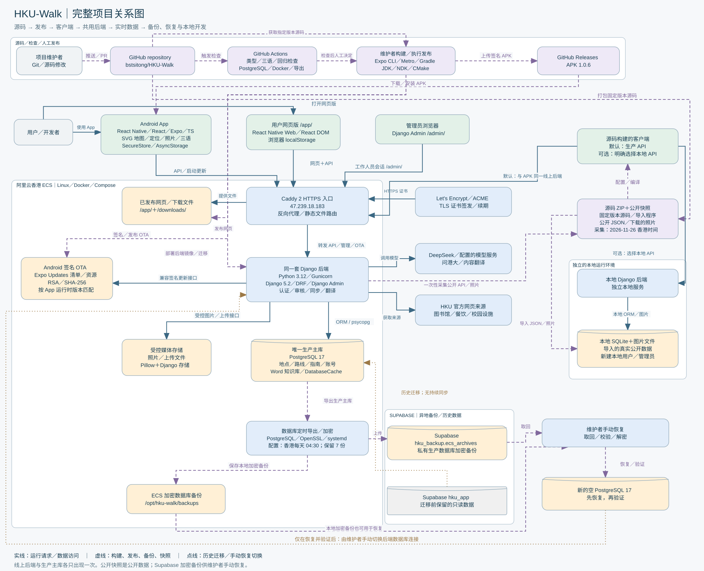

# 港大漫游 · HKU-Walk

面向香港大学学生与访客的校园地图和学生指南应用，将地点搜索、图文步行指引、校园生活资料、校园问答和经过审核的社区贡献集中在一起。

**[下载 Android 1.0.6](https://github.com/bstsitong/HKU-Walk/releases/download/v1.0.6/HKU-Walk-1.0.6.apk)** · [打开网页版](https://47.239.18.183/app/) · [查看源码](https://github.com/bstsitong/HKU-Walk) · [English README](README.md)

## 主要功能

| 功能 | 说明 |
| --- | --- |
| 校园地图 | 浏览地点和设施、缩放 SVG 地图、查看照片／入口／楼层信息及前台设备位置 |
| 地点搜索 | 支持名称、房号、英文简称、简繁中文、拼音、别名和近似拼写 |
| 步行指引 | 选择起终点，查看已发布路线、有序步骤、总览图和步骤大图 |
| 学生指南 | 入学资料、常用链接、美食与群组信息，支持文章搜索、Markdown 和图片 |
| 问港大 | 结合校园记录、参考文档和 HKU 官方网页回答问题并展示来源 |
| 账号与资料 | 注册登录、昵称／简介、头像／背景、密码、恢复码和署名可见性 |
| 收藏与历史 | 按账号隔离，通过本地缓存、待同步队列和后端同步保存个人记录 |
| 内容贡献 | 投稿地点、图文路线、指南和纠错，经审核发布，支持修改申请 |
| 讨论与消息 | 评论、回复、互动，以及审核／评论相关的应用内通知 |
| 三语 | 手机端与管理界面支持英文、简体中文和香港繁体中文 |

地图、指南和公开讨论可以直接浏览；投稿和个人功能需要 App 账号。路线按已发布记录查询，没有匹配路线时提示待添加。设备定位和路线示意图不代表已实现室内定位或经过实测的逐转向导航。

## 安装与使用

下载 APK 后打开，按 Android 提示允许浏览器或文件管理器安装应用。联网启动，等待兼容的签名启动更新完成，即可免登录浏览，或注册账号使用个人功能。独立 APK 无需 Expo Go 或开发电脑。

| Android 发布信息 | 数值 |
| --- | --- |
| 版本／版本号 | 1.0.6／10 |
| 应用 ID | `com.hkuwalk` |
| 支持架构 | ARM64 手机和 x86_64 模拟器 |
| 最低系统 | Android 7.0／API 24 |
| 文件大小 | 45,651,901 字节 |
| 发布页 | [v1.0.6](https://github.com/bstsitong/HKU-Walk/releases/tag/v1.0.6) |

APK SHA-256：

```text
1902493d37d1e521f2d372ed4b0c02ad421d66a12d7a0e67e85f347ac56f4911
```

[网页版](https://47.239.18.183/app/)使用同一套线上 API。它是额外部署的浏览器客户端，后续 Web 兼容修改未全部包含在每份源码快照中。原生 iOS 编译需要 macOS／Xcode 和单独的设备验证；这里提供的原生安装包为 Android。

## 项目架构与技术栈



[查看完整大图](architecture/architecture-zh.svg) · [可编辑 Mermaid](architecture/architecture-zh.mmd) · [完整技术清单](TECHNOLOGY_中文.md)

用户客户端和管理员浏览器通过 HTTPS 访问 Caddy。API 与管理请求进入同一套 Django 后端，再按权限读写生产 PostgreSQL；Caddy 另外提供已发布网页和下载文件。图中把模型调用、媒体访问、备份及发布流程连接到实际服务节点。

| 层次 | 技术与职责 |
| --- | --- |
| 用户端 | React 19.3.0、React Native 0.88.1、Expo SDK 58、TypeScript；浏览器使用 React Native Web／React DOM |
| 地图、搜索与媒体 | 自绘 SVG／react-native-svg、OpenStreetMap 底图来源、Expo Location、OpenCC、pinyin-pro、Markdown、Expo 相册／文件模块、Pillow |
| 设备状态 | 原生 SecureStore 保存凭据，AsyncStorage 保存设置／缓存／待同步记录；当前网页版使用 localStorage |
| 后端与管理端 | Python 3.12、Django 5.2.19、Django REST Framework 3.18.3、Django Admin、ORM 和 psycopg |
| 数据与存储 | 生产 PostgreSQL 17、独立本地 SQLite、Django 受控媒体、DatabaseCache；可选文件系统／数据库／私有 S3 媒体模式 |
| AI 与语言 | 可配置的 DeepSeek 兼容模型、Word 文本检索、项目／HKU 来源、内置翻译、OpenCC 香港繁体及 Django gettext |
| 生产托管 | 阿里云香港 ECS、Linux、Docker／Compose、Gunicorn、Caddy 2、Let's Encrypt／ACME、WhiteNoise |
| 备份恢复 | ECS 与 Supabase 加密 PostgreSQL 归档、OpenSSL、systemd 调度和手动恢复 |
| 开发与分发 | Git／GitHub、GitHub Actions、GitHub Releases、Expo CLI／Metro／Hermes、Android SDK／adb、JDK／Gradle／NDK／CMake、签名 Expo Updates |

GitHub 保存源码历史、检查结果和发布下载。后端部署、网页发布、Android OTA 发布及 APK 分发由维护者分别执行。Django Admin 是共用后端和模型的浏览器管理界面。

## 线上服务与数据

| 服务 | 地址 |
| --- | --- |
| API 根地址 | `https://47.239.18.183` |
| 健康检查 | <https://47.239.18.183/api/health/> |
| 用户网页版 | <https://47.239.18.183/app/> |
| 管理后台 | <https://47.239.18.183/admin/> |

实时主库是阿里云香港 ECS 上的 PostgreSQL。客户端通过 API 访问数据，不直接连接数据库。正常使用 App 不需要阿里云／Supabase 账号、SSH 或数据库密码；管理后台需要另行授权的工作人员账号。

### 运行模式

| 模式 | 后端与数据 | 修改保存到哪里 |
| --- | --- | --- |
| 安装正式 APK | 线上 Django API 和当前生产 PostgreSQL | 有权限的操作更新线上服务 |
| 源码客户端连接线上 API | 与 APK 相同的 API、公开数据和 App 账号 | 同一线上服务 |
| 客户端与后端都在本机运行 | 独立 Django、SQLite 和本地文件 | 仅本地环境 |

仅启动本地后端不会改变客户端的 API 地址。请在生成原生工程和打包之前设置 `EXPO_PUBLIC_API_URL`。不同账号仍只访问其权限范围内的私人记录。

### 公开内容快照

包含 `submission/data/public-content.json` 和 `submission/data/images/` 的源码归档附有 **2026 年 11 月 26 日香港时间**采集的公开内容：144 个基础地点、24 条路线、32 个设施、4 个指南分类、19 篇文章，以及对应 298 处公开图片 URL 的 182 份独立下载图片。这些是采集的记录和实际图片文件。

这类归档中的 `Start-Backend.ps1` 会把快照导入本地 SQLite 并创建本地管理员；普通 Git 克隆则初始化仓库内置内容。快照是独立副本，不与线上实时同步。真实密码、生产会话、私人记录和私有知识文档不随快照导出；公开署名可通过停用的替代账号保留。

### Supabase 备份

Supabase 的 `hku_backup.ecs_archives` 保存私有生产数据库加密归档，`hku_app` 保留迁移前只读数据。备份任务配置为香港时间每天 04:30 执行，ECS 和 Supabase 各保留最近 7 份。归档新鲜度、任务运行和恢复验证是不同检查项；已记录的检查日期、结果和文件覆盖范围见[技术清单](TECHNOLOGY_中文.md)。

恢复流程为摘要校验、私钥解密、恢复到新的空 PostgreSQL 17、验证，再手动切换后端连接。App 持续使用 ECS API，不读取备份归档或自动切换到 Supabase。文件系统媒体、OTA、网页／APK 文件除数据库 dump 外还需要独立的文件备份覆盖。

## 从源码运行 Android

准备 Node.js 24.x、npm、Android Studio、Android SDK 和兼容的 JDK。后端及可选的归档配置工具使用 Python 3.12。11 月 26 日的独立构建记录使用 Node 24.13.0、JDK 25、SDK 37、NDK 27.1.12297006；首次下载依赖需要联网。

克隆仓库或解压源码，在包含 `package.json` 的项目根目录打开终端。Windows 建议使用较短路径，例如 `C:\hku-walk\HKU-Walk`，减少原生 C++ 路径问题。以下命令使用 PowerShell；请从新副本开始，先选择后端，再生成原生工程。

```powershell
npm ci
if (Test-Path -LiteralPath submission/configure.py) {
    python submission/configure.py
} else {
    Set-Content -LiteralPath .env.local -Encoding ascii -Value 'EXPO_PUBLIC_API_URL=https://47.239.18.183'
    node -e "const fs=require('fs'); const p=JSON.parse(fs.readFileSync('app.json','utf8')); p.expo.android.package='com.hkuwalk.review'; p.expo.updates.enabled=false; fs.writeFileSync('app.json',JSON.stringify(p,null,2)+'\n');"
}
npm run locales:prepare
npx expo prebuild --platform android --no-install
npx expo run:android
```

先启动 Android 模拟器或连接已开启 USB 调试的设备。`expo run:android` 构建、安装开发版本并启动 Metro，开发期间保持 Metro 运行。`npm run android` 启动开发服务并尝试打开 Android，不等于编译独立 APK。

上述配置用 `com.hkuwalk.review` 标识独立本地构建，并关闭正式 OTA 下载，使其持续运行所选源码。它可与正式 APK 并存，也可访问相同线上 API。附有 `submission/configure.py` 的归档还会设置可跨电脑使用的 Android 构建选项；该工具须在生成原生工程前运行，更换其 API 时使用新副本。

macOS／Linux 按需使用 `python3`，通过配置工具或同一 Node 命令设置 App，并把相同 API 地址写入 `.env.local`，再执行 npm／Expo 命令。iOS 原生编译另需 macOS 和 Xcode。

### 构建独立 APK

完成配置和 prebuild 后执行：

```powershell
cd android
.\gradlew.bat assembleRelease
cd ..
```

macOS／Linux 使用 `./gradlew assembleRelease`。产物位于 `android/app/build/outputs/apk/release/app-release.apk`，内置 JavaScript bundle，可脱离 Metro 运行。生成的模板为此独立构建使用开发签名；正式升级需要正式签名密钥。在线功能仍连接所选后端。

## 在本机运行后端

在新源码副本中创建 Python 环境并启动 Django：

```powershell
python -m venv .venv
.\.venv\Scripts\python.exe -m pip install -r server/requirements.txt
.\Start-Backend.ps1
```

本地健康检查为 <http://127.0.0.1:8000/api/health/>，后台为 <http://127.0.0.1:8000/admin/>。数据库是 `.local/hku-walk.sqlite3`，新生成的管理员凭据在 `.local/admin-access.txt`。启动器执行迁移／初始化；附带公开快照的归档还会导入对应内容。重复启动保留本地账号和修改；快照导入程序拒绝覆盖另一套已有账号／投稿的数据库。

保持后端终端运行。在同一副本生成原生工程之前，选择本地 API：

```powershell
if (Test-Path -LiteralPath submission/configure.py) {
    python submission/configure.py --api-url http://10.0.2.2:8000
} else {
    Set-Content -LiteralPath .env.local -Encoding ascii -Value 'EXPO_PUBLIC_API_URL=http://10.0.2.2:8000'
    node -e "const fs=require('fs'); const p=JSON.parse(fs.readFileSync('app.json','utf8')); p.expo.android.package='com.hkuwalk.review'; p.expo.updates.enabled=false; fs.writeFileSync('app.json',JSON.stringify(p,null,2)+'\n');"
}
npm ci
npm run locales:prepare
npx expo prebuild --platform android --no-install
npx expo run:android
```

`10.0.2.2` 是 Android 模拟器访问宿主电脑的地址。实体手机使用电脑真实局域网 IP，在 `DJANGO_ALLOWED_HOSTS` 中允许该地址，让 Django 监听可访问网卡，并按需允许防火墙端口。附带快照的启动器接受 `-PublicOrigin`、`-ListenAddress`、`-Port`，导入图片原点与客户端 API 应一致。开发版本支持 HTTP；独立 HTTP 构建还需 Android 明文网络许可，归档中的原生配置工具会按 HTTP API 设置。

macOS／Linux 使用 `.venv/bin/python`。附带快照时运行 `submission/import_public_data.py --public-origin http://10.0.2.2:8000`；否则依次运行 `server/manage.py migrate --noinput`、`seed_guide`、`init_admin`。最后执行 `server/manage.py runserver 127.0.0.1:8000 --noreload`。

## 管理、AI 与语言

工作人员维护地点、设施、路线和指南并审核贡献。投稿状态为待审核、已通过、需修改和已拒绝；需修改可重交，已拒绝的请求关闭。已发布内容的修改申请通过之前，原公开版本仍然可见。

问港大使用后端配置的模型凭据，可检索启用的 Word 参考文档、项目公开记录和 HKU 官方网页。私有原文需工作人员权限，公开回答展示公开来源。本地 AI 需要自行配置模型密钥和参考材料，可使用 `DEEPSEEK_API_KEY`，或兼容的 `ASSISTANT_API_BASE_URL`、`ASSISTANT_API_KEY`、`ASSISTANT_MODEL`。源码对 DeepSeek 默认使用 `deepseek-flash`；供应商专用网页工具还需对应的支持配置。

App 与后台独立选择语言，数据库和编辑字段保留原文。地点介绍、已发布路线随界面语言翻译，社区帖子由用户触发翻译。英文词条及长篇指南译文位于 `locales/`，香港繁体使用 OpenCC，后台使用 Django gettext；动态翻译按原文版本／文本和目标语言缓存。维护规则见 [AGENTS.md](AGENTS.md)，服务配置见[部署说明](deploy/README.md)。

## 更新与部署

内容变化通过 API 刷新呈现；后端代码需要单独部署并按需迁移。兼容的 Android JavaScript／资源可导出、签名并发布到 ECS 的 Expo Updates 接口；原生依赖或运行时变化需要新 APK。网页变化需要重新导出并发布网页文件。Git 推送或 CI 检查通过不会自动完成这些发布。

正式构建使用 `assets/` 内的公开更新证书，签名私钥由维护者保管。代码回滚与数据库恢复分别处理。相关文件为 `deploy/`、`Dockerfile`、`scripts/prepare-android-update.mjs`。

## 源码结构与检查

| 路径 | 用途 |
| --- | --- |
| 根目录 `.ts`／`.tsx` | 页面、组件、状态、API、地图／搜索及共享逻辑 |
| `server/` | Django API／管理端、模型、迁移、共享 JSON 目录、初始化和测试 |
| `assets/`、`locales/` | 图像／地图资源、公开更新证书和三语资料 |
| `scripts/` | 语言／应用检查、生产验证与更新工具 |
| `deploy/`、`Dockerfile` | 生产环境、存储、备份／恢复工具 |
| `architecture/`、`TECHNOLOGY_中文.md` | 完整关系图与依赖／服务清单 |
| 附带的 `submission/` | 归档配置、公开快照、图片和校验信息 |

安装对应依赖后可执行：

```powershell
npx tsc --noEmit
npm run locales:check
node scripts/check-localization.cjs
node scripts/check-content-translation.cjs
npm run check:guide-reader
node scripts/check-app.cjs
.\.venv\Scripts\python.exe server/manage.py test guide community --noinput
.\.venv\Scripts\python.exe server/manage.py makemigrations --check --dry-run
npx expo export --platform android --output-dir .expo/source-check-export
```

这些是检查入口，不是一份新的测试通过记录。构建／导出、后端测试、模拟器、浏览器和实体设备分别验证不同范围，详细文档中保留相应验证记录。

## 常见问题

- 无法加载数据时先检查所选 API 的 `/api/health/`。线上功能需要互联网和可用服务器；手机的 localhost 不是电脑。
- `ANDROID_HOME`／`JAVA_HOME` 应指向本机 SDK／JDK，按 Gradle 提示安装组件并接受许可。
- Windows CMake 路径过长时使用短目录；未使用归档工具的构建，可在生成的 `android/app/build.gradle` 的 `android { ... }` 中加入以下设置，`projectRoot` 已由模板定义：

```groovy
externalNativeBuild.cmake.buildStagingDirectory file(System.getProperty("java.io.tmpdir") + "/hku-review-cxx-" + Integer.toHexString(projectRoot.hashCode()))
defaultConfig {
    externalNativeBuild.cmake.arguments "-DCMAKE_OBJECT_PATH_MAX=245"
}
```

- 若本地脚本策略阻止启动器，可使用 `powershell -NoProfile -ExecutionPolicy Bypass -File .\Start-Backend.ps1`，仅作用于该进程。
- 多个客户端要读取相同实时公开数据，应选择同一线上 API；独立修改使用本地后端。快照对应采集日期，不自动同步后续生产更改。

## 数据来源

道路与建筑轮廓参考 [OpenStreetMap contributors／ODbL](https://www.openstreetmap.org/copyright)。校园信息参考 HKU [校园地图](https://www.estates.hku.hk/download_file/view_inline/674)、[大学街地图](https://www.maps.hku.hk/downloads/201501hkumap.jpg)、[餐饮目录](https://catering.hku.hk/en/eateries/)、[无障碍资料](https://www.estates.hku.hk/campus-information/campus-accessibility/wheelchair-friendly-routes-hku-main-estate)、[停车资料](https://www.estates.hku.hk/our-services/facility-management/parking/parking-space-location-and-parking-fee)，并结合经过审核的贡献。具体记录保留来源／示意说明；内容、客户端代码和服务端配置可分别演进。
