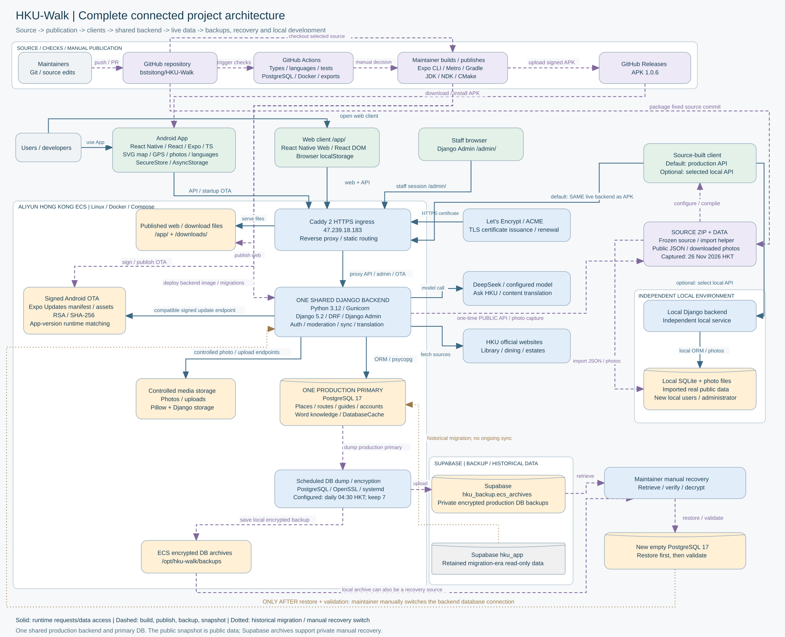

# HKU-Walk - Architecture and complete technology inventory

Documentation revision: **27 November 2026**. The source archive retains source commit `0fb24bd46a433e61fe317d858d4c7ffcc2506e51` and the public data captured on 26 November. Dependency versions below are read from the source archive, not inferred from product names. `~` is a declared version range; `package-lock.json` records exact npm resolutions. The app release version is **1.0.6** (`app.json`), while the internal npm package version remains 1.0.0.

[Full-size SVG](architecture/architecture-en.svg) · [Editable Mermaid topology](architecture/architecture-en.mmd) · [Setup and database modes](README.md)

This is one connected system diagram: the production backend and primary database each appear once. GitHub source feeds checks and maintainer-controlled publication; those release paths connect directly to the actual Android App, web files, Django backend and signed OTA assets. User and staff requests converge on the same Caddy/Django service and production PostgreSQL. Database backup arrows start at that same primary, and the recovery arrow returns to the same backend after manual validation and connection switching.

The source ZIP receives the fixed source version from GitHub and a one-time public JSON/photo capture through the production API. Its compiled client defaults to the same live backend as the APK; selecting the local API instead connects it to the independent Django/SQLite environment. Solid arrows represent runtime access, dashed arrows represent build/publication/backup/capture, and dotted arrows represent historical migration or a manual recovery switch.

## 1. Runtime layers, responsibilities and access

| Layer | Actual implementation and responsibility | Connection |
| --- | --- | --- |
| Ordinary users | Browse campus content; sign in to contribute, comment, react and synchronize personal records | Android App or the additional hosted web client uses Django HTTPS endpoints |
| Android frontend | React 19.3.0, React Native 0.88.1, Expo SDK 58 and TypeScript; custom components/styles, SVG icons and map | `guideApi.ts`, `communityApi.ts`, `assistantApi.ts` select the configured API origin; no direct SQL access |
| Hosted web frontend | React Native Web 0.21.4 / React DOM; published at <https://47.239.18.183/app/> | Caddy serves exported web files; the browser calls the same production API |
| Administrators | Django Admin and Django HTML templates with independent interface-language selection | Staff browser -> `/admin/` -> the same Django application, models and PostgreSQL as the public API |
| API and business logic | Python 3.12, Django 5.2.19, DRF 3.18.3; publication workflow, moderation, accounts, personal-record synchronization, AI and controlled images | Gunicorn on ECS; Django ORM / psycopg to PostgreSQL |
| Production data | PostgreSQL 17 on Aliyun Hong Kong ECS; live places, routes, guides, account/moderation records and private knowledge documents | Internal backend/database connection; database credentials stay on the server |
| Media and files | Django storage abstraction and permission-checked image handlers; OTA manifests/assets; separately published web/APK files | `community/images.py`, `community/storage.py`, `config/mobile_updates.py`; Caddy serves published web/download files |
| AI provider | Server-side configurable Chat Completions/tool-calling model service; source defaults to DeepSeek `deepseek-flash` | Backend holds model credentials and calls provider; API origin/model can be overridden server-side |
| Knowledge and external sources | Django-stored Word document originals/parsed text/chunks; campus catalog, guide and route records; allowlisted HKU official web sources | Backend selects evidence and fetches public sources for answers; private documents require staff access |
| Operations | Linux containers, Docker/Compose, Caddy 2 HTTPS/reverse proxy, Gunicorn, persistent volumes and systemd backup job | Aliyun ECS hosts production; GitHub is source/distribution infrastructure |

The web entry describes the current additional deployment. Web compatibility changes and `scripts/export-web.cjs` / `deploy/WEB.md` were added after the source snapshot and are not all present in this ZIP. Android is the documented source-build development workflow. The web client is not a native iOS build; no physical-iPhone verification is claimed. The generic `deploy/Caddyfile` in the source shows the base reverse-proxy setup; the deployed ECS configuration adds `/app/` and `/downloads/` static routing.

## 2. Feature-level technology and data flow

| Capability | Implementation / files | Where the data goes |
| --- | --- | --- |
| Campus map | Custom SVG artwork using `react-native-svg`; `MapCanvas.tsx`, `MapArtwork.ts`, map camera/marker helpers; OpenStreetMap-derived roads/buildings | Built-in map/catalog assets plus published campus API records; no live map-tile subscription is required |
| Device positioning | `expo-location`, `useCampusLocation.ts`, `campusLocation.ts` | Foreground device coordinates are transformed into campus-map coordinates; this is not verified indoor positioning or turn-by-turn navigation |
| Place search | Normalized names/codes, synonyms, OpenCC conversion and `pinyin-pro` | Local search/index logic, updated catalog records from the API |
| Route instructions | Django `CampusRoute` / ordered `RouteStep`, frontend route views and photos | API-published route content; some supplied walking steps/distances are demonstration content |
| Guides and community | Markdown renderer, structured text/image body blocks, Django publications/submissions/comments/reactions | Pending edits retain the published version until staff approval; changed/rejected states and inbox notices are backend records |
| Photos | Expo ImagePicker + ImageManipulator + FileSystem; custom crop UI; Pillow server validation/processing | App upload -> Django checks -> configured storage -> controlled image endpoint; web/APK downloads use a separate public directory |
| Three languages | English dictionaries and generated locale catalog; OpenCC Hong Kong Traditional conversion; Django gettext `.po` / `.mo`; source-revision-aware translation caches | Built-in translations are bundled; dynamic place/route translation uses backend model configuration; community post translation is user-triggered |
| Ask HKU | `guide/assistant.py`, `assistant_sources.py`, `knowledge.py`; Python ZIP/XML Word parsing, server tool calls, keyword/evidence retrieval from parsed chunks and app/HKU sources | Private Word originals and model keys remain server-side; public answers link public citations |
| App accounts | Django users, hashed passwords, custom random Bearer sessions with SHA-256 token hashes and recovery credentials | API authentication; native session credential in SecureStore; current hosted web uses same-origin browser localStorage |
| Staff accounts | Django staff permissions, session cookies and CSRF protection | Browser administration; a staff account is distinct from an ordinary app account and an Aliyun/Supabase cloud account |
| Local caches and personal state | AsyncStorage caches language/content/translations and account-scoped pending changes; personal collections/history synchronize via backend | Local device cache and account-scoped server records; a cache is not the shared database |
| Backend caching/limits | Django DatabaseCache (`app_cache`) in production; process-local cache in development; DRF throttles and database usage counters | Uses the existing database and Django cache framework |
| Static resources | Django collectstatic + WhiteNoise for Django assets; Caddy for exported web assets and APK download | Persistent server paths/volumes; different from the private database backup archive |

## 3. All data locations and backup/recovery roles

| Location | Role and contents | Used by normal App requests? |
| --- | --- | --- |
| ECS PostgreSQL | Current production primary; live data | Yes, through Django |
| Supabase `hku_backup.ecs_archives` | Private, encrypted point-in-time production PostgreSQL archives | No; maintainer recovery only |
| ECS `/opt/hku-walk/backups` | Local encrypted production database archives | No; recovery only |
| Supabase `hku_app` | Retained read-only snapshot from the previous deployment/migration period | No; not the current primary |
| Archive `submission/data/` | Captured PUBLIC API JSON and image bytes, with checksums | Used to populate the independent local local environment |
| Local `.local/hku-walk.sqlite3` | SQLite generated/imported on the local computer; new local accounts | Only when the source client is explicitly configured for that local Django backend |
| Device storage | SecureStore / AsyncStorage; browser localStorage in the current web deployment | Credentials, settings, caches and pending records, rather than an entire production database |
| Source assets / JSON / locales | Bundled artwork, guide images, built-in content and language files | Loaded locally by the frontend and supplemented by published API data |

The configured production database backup job is `hku-walk-db-backup.service`: daily **04:30 Hong Kong time**, retaining the latest **7** archives on ECS and in Supabase. It uses PostgreSQL dump archives, OpenSSL encryption and checksums. If upload fails, the local encrypted archive can remain available. A Supabase backup is separate from the former `hku_app` snapshot and from the public-data public snapshot.

**Observed backup metadata, 27 November 2026, Hong Kong time:** a read-only query found **7** `primary-%` archives in `hku_backup.ecs_archives`; the latest recorded `captured_at` was **24 November 2026 06:01:00 HKT** (`2026-11-23 22:01:00.783852+00:00`). This confirms the records available at inspection, not that every subsequent scheduled run succeeded. ECS-local retention, current job logs, archive decryption and a full restore were not rechecked for this documentation revision.

Recovery is a maintainer operation: retrieve an encrypted archive -> verify its checksum -> decrypt using the private recovery key -> restore into a **new empty PostgreSQL 17 database** -> validate -> manually switch the backend connection. Recovery depends on the most recent successful backup and does not provide automatic failover or live replication. Signing/decryption keys and private connection settings are not included in the source ZIP.

Database-only dump coverage must not be confused with every server file. Private Word originals are database records; photo bytes are part of a database dump only when `DatabaseStorage` is selected. Filesystem media, signed OTA files and exported web/APK files require their own file/portable backup coverage. The source supports filesystem, database and private S3 media modes; the active ECS media mode and full-file backup coverage were not queried during this revision. `backup_project` / `restore_project` provide a separate portable JSON/image/checksum backup route; their existence is not a claim that the daily encrypted database job also archives every filesystem asset.

## 4. Source, builds, releases and update boundaries

| Tool / service | Actual role |
| --- | --- |
| Git / GitHub | Source/history/collaboration, repository <https://github.com/bstsitong/HKU-Walk>; no production database credentials are required to inspect the ZIP |
| GitHub Actions | Push/PR checks: TypeScript, three-language audits/regressions, guide/app checks, Expo Android/iOS exports, Django/PostgreSQL integration and Docker checks; it does not deploy ECS or publish OTA |
| Node.js 24 / npm / lockfile | Frontend dependency installation (`npm ci`), CLI/scripts and reproducible npm resolutions |
| Expo CLI / Metro / Hermes | Development server/bundler, platform exports, native prebuild; native Android runtime executes the packaged/exported JavaScript |
| Android Studio / SDK / Emulator / adb | Android development, emulator/device launch, installation and inspection |
| JDK / Gradle wrapper / NDK / CMake | Generate/compile the Android native project and its native dependencies; the project README records the tested local toolchain |
| Python / pip / venv / PowerShell | Isolated backend dependencies, local configuration/import and Windows launch helpers |
| Django test runner / migration checks | Temporary test databases, business-logic/API/storage checks and schema consistency checks |
| TypeScript / React test renderer | Type checks and script/component/application regression checks; esbuild is separately declared as a development dependency |
| GNU gettext | Compile staff-interface `.po` source messages to `.mo` catalogs |
| Docker / Compose / Caddy / Gunicorn | Production container image, orchestration, persistent services, HTTPS ingress and Python WSGI processes |
| Let's Encrypt / ACME | Certificate issuance/renewal configured through Caddy for the public HTTPS IP origin |
| Download links / QR codes | Public HTTPS APK and web entry URLs; QR distribution artifacts generated with Python qrcode / Pillow and decoded with zxing-cpp for checks, outside the frozen source snapshot |
| GitHub REST API / Python requests | Maintainer release-upload helper outside the frozen source snapshot; ordinary App requests go to Django, not to this publishing API |
| PostgreSQL dump/restore / OpenSSL / systemd | Production database backup, encryption/decryption, scheduling and manual recovery |
| SHA-256 | Submission file manifest, downloaded image verification, release/asset checks and stored session-token hashes |
| GitHub Releases | Public APK distribution: [v1.0.6](https://github.com/bstsitong/HKU-Walk/releases/tag/v1.0.6), [APK download](https://github.com/bstsitong/HKU-Walk/releases/download/v1.0.6/HKU-Walk-1.0.6.apk) |
| Expo Updates + custom signed delivery | `StartupUpdate.tsx`, `scripts/prepare-android-update.mjs`, `server/config/mobile_updates.py`; RSA/SHA-256 signed compatible Android manifests/assets hosted on ECS; app carries a public certificate |

Changes reach users through different operations: content approval updates production records; backend changes require image deployment/migrations; compatible Android JavaScript/assets require a separately signed/published OTA; native dependencies/runtime/signing changes require a new APK; web changes require exporting/publishing web files. An npm install, Git push or successful CI run alone does not perform these publications. The source snapshot configuration disables production OTA to retain the submitted mobile code while still allowing live API data.

## 5. Supported, historical and independently configured components

| Component | Status |
| --- | --- |
| Aliyun ECS + PostgreSQL + Django + Caddy | Current production architecture; no cloud login is needed for ordinary App/API use |
| Supabase encrypted archives | Current off-site backup role; metadata observed as recorded above |
| Render + former Supabase application schema | Previous preview/deployment path; retained read-only migration-era data does not replace current ECS production |
| S3-compatible storage / django-storages / boto3 | Implemented optional storage mode; not a confirmed active production bucket |
| Waitress | Supported cross-platform WSGI/verification path; ECS startup uses Gunicorn |
| Local SQLite + public JSON/photos | Independent local development mode; not a synchronized production replica |
| Expo cloud / EAS, Expo Go | Not required for the supplied native source-build route; the signed OTA route is custom ECS hosting rather than an asserted EAS Update deployment |
| iOS native target | Source configuration and CI export support exist; native compilation requires macOS/Xcode; no submitted IPA or native-iPhone test is claimed |

## 6. Complete declared dependency inventory

The following includes every direct dependency declared in the `package.json` and every pinned entry in `server/requirements.txt`, including support libraries. Transitive npm packages remain exhaustively recorded in `package-lock.json`; generated Android dependencies are resolved by the generated Gradle project. A library being installed is distinguished above from a cloud service actually being deployed.

### Application dependencies

| Package | Declared version | Purpose |
| --- | --- | --- |
| `@believer/react-native-markdown-display` | `8.4.1` | Guide Markdown rendering |
| `@react-native-async-storage/async-storage` | `2.2.0` | Language, content and translation caches; account-scoped pending personal records |
| `expo` | `~58.0.23` | Expo SDK, CLI, prebuild and platform integration |
| `expo-constants` | `~58.0.15` | Runtime/development host configuration |
| `expo-file-system` | `58.0.13` | Photo file reading, upload preparation and temporary files |
| `expo-image-manipulator` | `~58.0.16` | On-device photo crop/resize/compression |
| `expo-image-picker` | `~58.0.10` | Choose profile and contribution photos from the photo library |
| `expo-location` | `~58.0.20` | Foreground device positioning for the campus map |
| `expo-secure-store` | `~58.0.2` | Native secure storage for app session credentials |
| `expo-splash-screen` | `~58.0.13` | Native launch/splash screen |
| `expo-status-bar` | `~58.0.4` | System status bar integration |
| `expo-updates` | `~58.0.22` | Compatible, signed Android JavaScript/asset updates |
| `opencc-js` | `1.4.2` | Simplified/Traditional Chinese conversion and search normalization |
| `pinyin-pro` | `3.29.5` | Pinyin aliases in campus place search |
| `react` | `19.3.0` | Component/state rendering layer |
| `react-native` | `0.88.1` | Native mobile UI and platform bridge |
| `react-native-safe-area-context` | `~5.11.1` | Screen insets and safe-area layout |
| `react-native-svg` | `15.16.0` | Campus SVG artwork, map overlays and custom icons |

### Development dependencies

| Package | Declared version | Purpose |
| --- | --- | --- |
| `@types/react` | `~19.3.0` | React TypeScript definitions |
| `esbuild` | `0.28.2` | Declared development bundler; not an application runtime service |
| `react-dom` | `19.3.0` | Browser rendering used by the web target |
| `react-native-web` | `0.21.4` | Reuse React Native components in the browser |
| `react-test-renderer` | `19.3.0` | Component/application regression checks |
| `typescript` | `~6.0.3` | Type checking for application and shared logic |

### Backend pinned dependencies

| Package | Pinned version / condition | Purpose |
| --- | --- | --- |
| `Django` | `5.2.19` | Models/ORM, migrations, accounts, admin, permissions and server framework |
| `asgiref` | `3.13.0` | Django sync/async interoperability dependency |
| `sqlparse` | `0.6.1` | SQL parsing/formatting support used by Django |
| `tzdata` | `2026.6` | IANA time zones, including Asia/Hong_Kong |
| `djangorestframework` | `3.18.3` | JSON REST endpoints, serializers, authentication and throttling |
| `Pillow` | `13.0.0` | Server image verification, decoding, resizing and metadata cleanup |
| `dj-database-url` | `3.1.2` | Parse DATABASE_URL into Django database configuration |
| `psycopg[binary]` | `3.3.8` | PostgreSQL driver; private backup retrieval tooling |
| `whitenoise` | `6.12.0` | Compressed, hashed Django static assets |
| `waitress` | `3.0.2` | Cross-platform WSGI server supported by production verification tooling |
| `gunicorn` | `26.2.0; sys_platform != "win32"` | Linux production WSGI workers on ECS; excluded on Windows |
| `django-storages[s3]` | `1.14.6` | Optional private S3 storage adapter; not evidence of a deployed S3 bucket |
| `boto3` | `1.43.124` | SDK dependency for the optional S3 storage mode |

## 7. Evidence in the project

- `package.json`, `package-lock.json`, `app.json`, `metro.config.js`: frontend dependencies, app identity and bundling.
- `MapCanvas.tsx`, `MapArtwork.ts`, `useCampusLocation.ts`, `placeMatching.ts`, `localization.ts`, `locales/`: map, location, search and languages.
- `server/config/settings.py`, `server/config/urls.py`, `server/community/`, `server/guide/`: storage, authentication, models, API, admin, AI and translations.
- `Dockerfile`, `deploy/compose.yaml`, `deploy/entrypoint.py`, `deploy/README.md`, `.github/workflows/check.yml`: production baseline and automated checks.
- `submission/`, `Start-Backend.ps1`, `submission/FILE_SHA256.json`: archive setup, captured public content and file integrity.
- Current deployment notes and private recovery configuration were checked separately from the frozen source snapshot. Private configuration, credentials and recovery/signing keys are intentionally omitted from this submission.

Map attribution: OpenStreetMap contributors (ODbL), plus referenced HKU campus maps, dining, accessibility and parking information; see `README.md` for the original source links. HKU official web sources used for answers are external content sources, not project-owned backend services. AI answers depend on provider/network availability and the backend configuration; other core browsing/account functions do not require a local model key.
