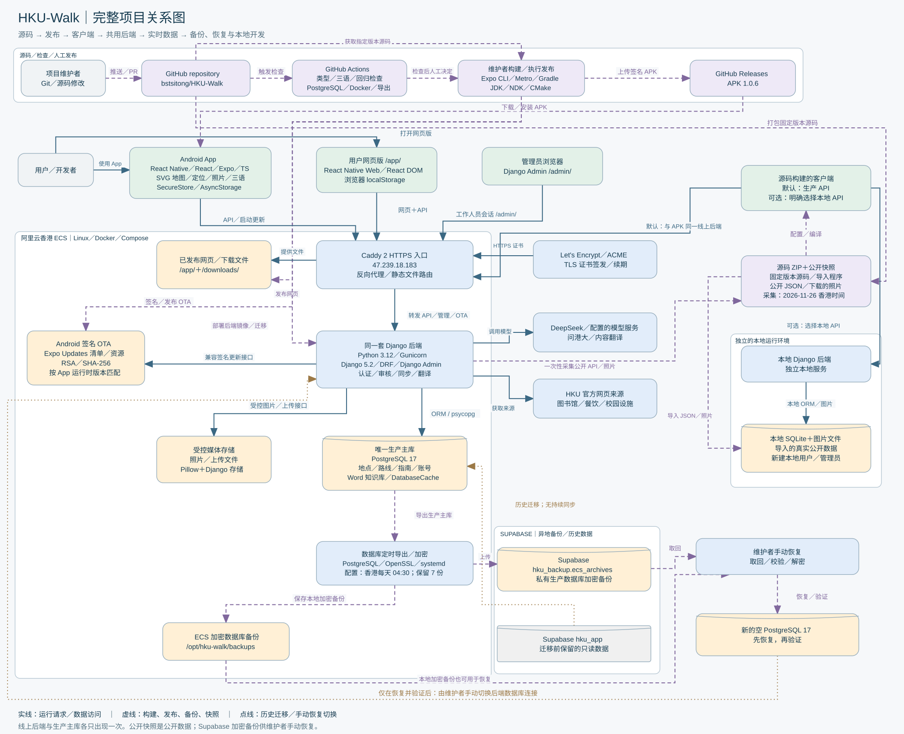

# HKU-Walk｜项目架构与完整技术清单

文档修订：**2026 年 11 月 27 日**。源码归档仍保留提交 `0fb24bd46a433e61fe317d858d4c7ffcc2506e51`，公开数据仍为 11 月 26 日采集的快照。下列依赖版本从提交 ZIP 中读取。`~` 表示声明的版本范围，npm 精确解析版本由 `package-lock.json` 保存。App 发布版本为 **1.0.6**（见 `app.json`），内部 npm 包版本仍为 1.0.0。

[查看可放大的 SVG](architecture/architecture-zh.svg) · [可编辑 Mermaid 关系图](architecture/architecture-zh.mmd) · [本地运行与数据库说明](README.zh-CN.md)

这是一张完整连通的系统关系图，线上后端与生产主库各只出现一次：GitHub 源码进入检查与维护者发布流程，发布箭头直接接到实际的 Android App、网页文件、Django 后端和签名 OTA 资源。用户与管理员的请求汇入同一套 Caddy／Django 服务，再访问同一个生产 PostgreSQL。备份从这个主库导出；恢复后的数据库在验证并手动切换连接后，重新接回同一个后端。

源码 ZIP 同时接收固定版本源码，以及通过生产 API 一次性采集的公开 JSON／照片。本地用户编译的客户端默认与 APK 连接同一线上后端；明确选择本地 API 时，才连接独立的 Django／SQLite 环境。实线表示运行访问，虚线表示构建／发布／备份／采集，点线表示历史迁移或手动恢复切换。

## 1. 运行层次、职责与访问关系

| 层次 | 实际实现与职责 | 如何连接 |
| --- | --- | --- |
| 普通用户 | 浏览校园内容；登录后投稿、评论、互动和同步个人记录 | 通过 Android App 或已部署的用户网页版调用 Django HTTPS 接口 |
| Android 前端 | React 19.3.0、React Native 0.88.1、Expo SDK 58、TypeScript；自定义组件／样式、SVG 图标和地图 | `guideApi.ts`、`communityApi.ts`、`assistantApi.ts` 使用配置的 API 地址，不直接执行 SQL |
| 用户网页版 | React Native Web 0.21.4／React DOM；入口 <https://47.239.18.183/app/> | Caddy 提供导出的网页文件；浏览器访问同一套生产 API |
| 管理员端 | Django Admin 和 Django HTML 模板；管理界面可以独立切换语言 | 工作人员浏览器 → `/admin/` → 与用户 API 共用的 Django 应用、模型及 PostgreSQL |
| 后端业务与 API | Python 3.12、Django 5.2.19、DRF 3.18.3；发布审核、账号、个人记录同步、AI 及受控图片接口 | ECS 上由 Gunicorn 执行；通过 Django ORM／psycopg 连接 PostgreSQL |
| 生产数据 | 阿里云香港 ECS 上的 PostgreSQL 17；实时地点、路线、指南、账号／审核记录和私有知识文档 | 数据库连接只供后端使用，数据库凭据留在服务器 |
| 媒体与文件 | Django 存储抽象与权限控制图片接口；OTA 清单／资源；另外发布的网页／APK 文件 | `community/images.py`、`community/storage.py`、`config/mobile_updates.py`；Caddy 提供已发布网页和下载文件 |
| AI 服务 | 后端配置的 Chat Completions／工具调用模型服务；源码默认 DeepSeek `deepseek-flash` | 模型凭据由后端持有；服务地址和模型可在后端覆盖配置 |
| 知识与外部来源 | Django 保存的 Word 原件、解析文本及分段；校园地点、指南和路线；允许访问的 HKU 官方网页 | 后端检索证据、获取公开来源并组织回答；私有原文只供工作人员访问 |
| 运维 | Linux 容器、Docker／Compose、Caddy 2 HTTPS／反向代理、Gunicorn、持久化卷及 systemd 备份任务 | 阿里云 ECS 承担生产运行；GitHub 承担源码管理和分发 |

网页版是当前额外部署的客户端。Web 兼容修改以及 `scripts/export-web.cjs`、`deploy/WEB.md` 添加于本次归档源码快照之后，未全部包含在此 ZIP 中。归档源码编译流程以 Android 为主。网页版不等于原生 iOS 应用，本说明不声称做过真实 iPhone 验证。源码中的通用 `deploy/Caddyfile` 展示基础反向代理；实际 ECS 发布配置增加了 `/app/` 和 `/downloads/` 静态文件路由。

## 2. 各项功能实际使用的技术与数据去向

| 能力 | 实现／文件 | 数据如何流动 |
| --- | --- | --- |
| 校园地图 | `react-native-svg` 自绘 SVG 底图；`MapCanvas.tsx`、`MapArtwork.ts` 及相机／标记布局辅助模块；道路建筑参考 OpenStreetMap | 内置地图／目录资源结合校园 API 已发布记录；无需在线地图瓦片订阅 |
| 当前位置 | `expo-location`、`useCampusLocation.ts`、`campusLocation.ts` | 将设备前台定位转换到校园地图坐标；不等同于已验证的室内定位或逐转向导航 |
| 地点搜索 | 名称／房号归一化、同义词、OpenCC 简繁转换和 `pinyin-pro` | 本地索引与匹配逻辑，结合 API 更新的地点目录 |
| 路线步骤 | Django `CampusRoute`／有序 `RouteStep`，前端路线视图和步骤图片 | 后端发布的路线内容；部分行走步骤及距离属于演示数据 |
| 指南与社区 | Markdown 渲染、结构化文字／图片正文块、Django 发布／投稿／评论／互动模型 | 修改审核通过前保留旧公开版本；修改请求、拒绝状态和消息通知保存于后端 |
| 照片 | Expo ImagePicker、ImageManipulator、FileSystem、自定义裁剪界面；服务端 Pillow 验证处理 | App 上传 → Django 校验 → 配置的存储 → 受控图片接口；网页／APK 下载使用独立公开目录 |
| 三语 | 英文字典、生成的语言目录、OpenCC 香港繁体转换；Django gettext `.po`／`.mo`；按原文版本缓存动态翻译 | 内置翻译随应用打包；地点／路线动态翻译依赖后端模型；社区帖子由用户点击翻译 |
| 问港大 | `guide/assistant.py`、`assistant_sources.py`、`knowledge.py`；Python ZIP／XML 解析 Word、服务端工具调用、文本分段关键词／证据检索、项目数据及 HKU 来源 | 私有原文和模型密钥留在服务端，公开回答引用公开来源 |
| App 账号 | Django 用户及密码哈希；随机 Bearer 会话、服务端 SHA-256 token 哈希、恢复凭据 | API 认证；原生端 SecureStore 保存会话；当前网页版使用同源 localStorage |
| 管理员账号 | Django 工作人员权限、会话 cookie 和 CSRF 防护 | 浏览器管理后台；工作人员账号、普通 App 账号和阿里云／Supabase 云账号属于不同权限 |
| 缓存与个人记录 | AsyncStorage 保存语言、内容、翻译缓存及按账号隔离的待同步更改；个人收藏／历史通过后端同步 | 数据保存在设备缓存和按账号隔离的服务端记录中；缓存不等于共享数据库 |
| 后端缓存与限额 | 生产环境 Django DatabaseCache（`app_cache`），开发环境进程内缓存；DRF 限流和数据库用量计数 | 复用现有数据库及 Django 缓存框架 |
| 静态资源 | Django collectstatic／WhiteNoise 处理 Django 静态资源；Caddy 提供网页导出资源和 APK 下载 | 服务器持久化目录／卷；这些文件与私有数据库加密备份属于不同对象 |

## 3. 所有数据位置、备份与恢复职责

| 位置 | 作用与内容 | 普通 App 请求是否使用 |
| --- | --- | --- |
| ECS PostgreSQL | 当前生产主库，保存实时数据 | 是，但通过 Django 访问 |
| Supabase `hku_backup.ecs_archives` | 私有、加密的生产 PostgreSQL 时间点备份 | 否，仅供维护者恢复 |
| ECS `/opt/hku-walk/backups` | 本地加密生产数据库备份 | 否，仅供恢复 |
| Supabase `hku_app` | 之前部署／迁移期间保留下来的只读快照 | 否，不是当前生产主库 |
| 源码归档中的 `submission/data/` | 公开 API JSON、实际图片文件和校验信息 | 用来填充独立本地本地环境 |
| 本机的 `.local/hku-walk.sqlite3` | 在本机创建、导入快照并新建账号的 SQLite | 仅当源码手机端明确配置为连接该本地 Django 时使用 |
| 设备存储 | SecureStore／AsyncStorage；当前网页版使用浏览器 localStorage | 保存凭据、偏好、缓存和待同步记录，不是整份生产数据库 |
| 源码资源／JSON／locales | 内置地图、指南原图、初始内容和语言文件 | 前端本地加载，并结合 API 已发布内容 |

生产数据库备份任务配置为 `hku-walk-db-backup.service`：香港时间**每天 04:30** 执行，ECS 和 Supabase **各保留最近 7 份**。使用 PostgreSQL dump、OpenSSL 加密和摘要校验。上传失败时，本地加密备份仍可保留。Supabase 里的生产加密备份、旧 `hku_app` 快照、公开数据快照是三种不同用途的数据。

**2026 年 11 月 27 日（香港时间）实际查询结果：** 只读查询在 `hku_backup.ecs_archives` 中查到 **7** 份 `primary-%` 备份，最新记录的 `captured_at` 为**2026 年 11 月 24 日 06:01:00 香港时间**（UTC 原值 `2026-11-23 22:01:00.783852+00:00`）。这说明检查时有哪些记录，不能证明之后每天的定时任务都成功。本次文档修订未重新检查 ECS 本地保留数量、当前任务日志、解密和完整恢复。

恢复由维护者执行：取回加密备份 → 校验摘要 → 使用私有恢复密钥解密 → 恢复到**新的空 PostgreSQL 17 数据库** → 验证 → 手动切换后端连接。可恢复到哪个时间点取决于最近成功备份，不提供自动故障切换或实时复制。源码 ZIP 不包含解密／签名私钥及私有连接配置。

数据库 dump 的覆盖范围不能直接等同于全部服务器文件。私有 Word 原件保存在数据库中；照片只有在选择 `DatabaseStorage` 时，字节才会随数据库 dump 保存。文件系统媒体、签名 OTA 文件、网页导出和 APK 需要各自的文件／便携备份覆盖。源码支持文件系统、数据库及私有 S3 三种媒体存储；本次修订未查询 ECS 当前启用的媒体模式和完整文件备份范围。`backup_project`／`restore_project` 提供另一套可移植 JSON／图片／摘要备份方式，但有这套工具不代表每日加密数据库任务同时包含所有文件资源。

## 4. 源码、构建、发布和更新边界

| 工具／服务 | 实际用途 |
| --- | --- |
| Git／GitHub | 源码、历史和协作；仓库 <https://github.com/bstsitong/HKU-Walk>；查看 ZIP 无需生产数据库凭据 |
| GitHub Actions | 推送／PR 后检查 TypeScript、三语及切换回归、指南／应用、Expo Android／iOS 导出、Django／PostgreSQL 集成和 Docker；不负责 ECS 部署或 OTA 发布 |
| Node.js 24／npm／lockfile | `npm ci` 安装前端依赖，执行 CLI／脚本，锁定 npm 精确解析版本 |
| Expo CLI／Metro／Hermes | 开发服务、打包、平台导出、原生工程生成；Android 原生运行时执行应用 JavaScript |
| Android Studio／SDK／Emulator／adb | Android 开发、模拟器／设备启动、安装及检查 |
| JDK／Gradle wrapper／NDK／CMake | 生成／编译 Android 原生工程及其原生依赖；README 记录已验证的本地工具链 |
| Python／pip／venv／PowerShell | 隔离后端依赖、本地构建配置／导入及 Windows 启动辅助脚本 |
| Django 测试运行器／迁移检查 | 使用临时测试数据库，检查业务／API／存储和模型迁移一致性 |
| TypeScript／React test renderer | 类型检查及脚本／组件／应用回归检查；esbuild 另列为声明的开发依赖 |
| GNU gettext | 将管理界面 `.po` 翻译源编译为 `.mo` |
| Docker／Compose／Caddy／Gunicorn | 生产镜像、编排、持久化服务、HTTPS 入口和 Python WSGI 进程 |
| Let's Encrypt／ACME | Caddy 为公网 HTTPS IP 地址配置证书签发和续期 |
| 下载链接／二维码 | 公开的 HTTPS APK 与网页入口；二维码分发文件由 Python qrcode／Pillow 生成，zxing-cpp 解码核验，位于冻结源码快照之外 |
| GitHub REST API／Python requests | 冻结源码之外的维护者发布上传脚本使用；普通 App 请求访问 Django，而非此发布 API |
| PostgreSQL dump／restore、OpenSSL、systemd | 数据库备份、加解密、任务调度与手动恢复 |
| SHA-256 | 提交包文件清单、下载图片校验、发布／资源完整性及会话 token 哈希 |
| GitHub Releases | 公开 APK 分发：[v1.0.6](https://github.com/bstsitong/HKU-Walk/releases/tag/v1.0.6)、[点击下载 APK](https://github.com/bstsitong/HKU-Walk/releases/download/v1.0.6/HKU-Walk-1.0.6.apk) |
| Expo Updates＋自建签名分发 | `StartupUpdate.tsx`、`scripts/prepare-android-update.mjs`、`server/config/mobile_updates.py`；ECS 托管兼容的 Android RSA／SHA-256 签名清单和资源，App 内置公钥证书 |

内容审核通过后改变生产记录；后端修改需要部署镜像及迁移；兼容 Android JavaScript／资源修改需要另外签名并发布 OTA；原生依赖、运行时或签名变化需要新的 APK；网页修改需要重新导出并发布网页文件。安装依赖、Git 推送或 CI 成功本身不会完成这些发布。归档源码配置关闭生产 OTA，让本地用户运行提交的手机端代码，同时仍可通过 API 读取实时数据。

## 5. 当前使用、可选支持与历史保留

| 组件 | 状态 |
| --- | --- |
| 阿里云 ECS＋PostgreSQL＋Django＋Caddy | 当前生产架构；普通 App／API 使用者无需登录云控制台 |
| Supabase 加密备份 | 当前异地备份用途；已查询的记录情况见上文 |
| Render＋原 Supabase 应用 schema | 之前的预览／部署路径；保留的只读迁移前数据不能代替当前 ECS 主库 |
| S3 兼容存储／django-storages／boto3 | 代码实现了可选存储模式，未确认当前生产使用 S3 桶 |
| Waitress | 支持的跨平台 WSGI／生产验证路径；ECS 启动使用 Gunicorn |
| 本地 SQLite＋公开 JSON／图片 | 独立本地开发环境，不与生产实时同步 |
| Expo 云服务／EAS、Expo Go | 所附原生源码编译流程不需要；现有签名 OTA 为 ECS 自建托管，未声称使用 EAS Update 部署 |
| iOS 原生目标 | 有源码配置和 CI 导出支持；原生编译需要 macOS／Xcode；未提供 IPA，也未声称完成原生 iPhone 测试 |

## 6. 全部声明依赖清单

以下覆盖提交版 `package.json` 的全部直接依赖和 `server/requirements.txt` 的全部固定条目，包括框架的辅助库。npm 间接依赖的完整版本保存在 `package-lock.json`；Android 原生间接依赖由生成后的 Gradle 工程解析。依赖包存在与某项云服务实际部署的区别已在上文注明。

### 应用直接依赖

| 包名 | 声明版本 | 用途 |
| --- | --- | --- |
| `@believer/react-native-markdown-display` | `8.4.1` | 指南 Markdown 正文渲染 |
| `@react-native-async-storage/async-storage` | `2.2.0` | 语言、内容、翻译缓存及按账号隔离的待同步个人记录 |
| `expo` | `~58.0.23` | Expo SDK、CLI、原生工程生成和平台集成 |
| `expo-constants` | `~58.0.15` | 运行时及开发主机信息 |
| `expo-file-system` | `58.0.13` | 照片文件读取、上传准备和临时文件 |
| `expo-image-manipulator` | `~58.0.16` | 设备端照片裁剪、缩放和压缩 |
| `expo-image-picker` | `~58.0.10` | 从相册选择头像、背景及投稿配图 |
| `expo-location` | `~58.0.20` | 校园地图的前台设备定位 |
| `expo-secure-store` | `~58.0.2` | 原生端安全保存 App 会话凭据 |
| `expo-splash-screen` | `~58.0.13` | 原生启动画面 |
| `expo-status-bar` | `~58.0.4` | 系统状态栏适配 |
| `expo-updates` | `~58.0.22` | 兼容的 Android 签名 JavaScript／资源更新 |
| `opencc-js` | `1.4.2` | 简繁转换及搜索文本归一化 |
| `pinyin-pro` | `3.29.5` | 校园地点搜索的拼音匹配 |
| `react` | `19.3.0` | 组件、状态与渲染层 |
| `react-native` | `0.88.1` | 原生移动界面和平台桥接 |
| `react-native-safe-area-context` | `~5.11.1` | 屏幕边距和安全区域布局 |
| `react-native-svg` | `15.16.0` | 校园 SVG 底图、地图叠加图层和自定义图标 |

### 开发直接依赖

| 包名 | 声明版本 | 用途 |
| --- | --- | --- |
| `@types/react` | `~19.3.0` | React 的 TypeScript 类型定义 |
| `esbuild` | `0.28.2` | 声明的开发打包工具，不是应用运行时服务 |
| `react-dom` | `19.3.0` | Web 目标的浏览器渲染 |
| `react-native-web` | `0.21.4` | 在浏览器中复用 React Native 组件 |
| `react-test-renderer` | `19.3.0` | 组件和应用回归检查 |
| `typescript` | `~6.0.3` | 应用和共享逻辑的类型检查 |

### 后端固定依赖

| 包名 | 固定版本／条件 | 用途 |
| --- | --- | --- |
| `Django` | `5.2.19` | 模型／ORM、迁移、账号、管理后台、权限及服务框架 |
| `asgiref` | `3.13.0` | Django 同步／异步适配依赖 |
| `sqlparse` | `0.6.1` | Django 使用的 SQL 解析／格式化依赖 |
| `tzdata` | `2026.6` | IANA 时区数据，包括香港时区 |
| `djangorestframework` | `3.18.3` | JSON REST 接口、序列化、认证和限流 |
| `Pillow` | `13.0.0` | 服务端图片校验、解码、缩放及元数据清理 |
| `dj-database-url` | `3.1.2` | 将 DATABASE_URL 解析为 Django 数据库配置 |
| `psycopg[binary]` | `3.3.8` | PostgreSQL 驱动及私有备份取回工具 |
| `whitenoise` | `6.12.0` | Django 静态资源压缩和带摘要的资源服务 |
| `waitress` | `3.0.2` | 生产验证工具支持的跨平台 WSGI 服务 |
| `gunicorn` | `26.2.0; sys_platform != "win32"` | ECS 上的 Linux 生产 WSGI 进程；Windows 不安装 |
| `django-storages[s3]` | `1.14.6` | 可选的私有 S3 存储适配；依赖存在不代表已部署 S3 桶 |
| `boto3` | `1.43.124` | 可选 S3 存储模式使用的 SDK 依赖 |

## 7. 可核对的项目文件

- `package.json`、`package-lock.json`、`app.json`、`metro.config.js`：前端依赖、App 标识和打包。
- `MapCanvas.tsx`、`MapArtwork.ts`、`useCampusLocation.ts`、`placeMatching.ts`、`localization.ts`、`locales/`：地图、定位、搜索和三语。
- `server/config/settings.py`、`server/config/urls.py`、`server/community/`、`server/guide/`：存储、认证、模型、API、管理端、AI 和翻译。
- `Dockerfile`、`deploy/compose.yaml`、`deploy/entrypoint.py`、`deploy/README.md`、`.github/workflows/check.yml`：生产基础配置和自动检查。
- `submission/`、`Start-Backend.ps1`、`submission/FILE_SHA256.json`：归档配置、公开数据快照和文件完整性。
- 当前部署说明与私有恢复配置另行核对，不混同为冻结的源码快照；私有配置、凭据、恢复／签名密钥未放入提交包。

地图来源包括 OpenStreetMap contributors（ODbL），以及引用的 HKU 校园地图、餐饮、无障碍与停车信息；原始来源链接见 `README.zh-CN.md`。问答使用的 HKU 官方网页是外部内容来源，不是项目自行运行的服务。AI 回答取决于模型服务、网络和后端配置；其他核心浏览／账号功能不要求本地配置模型密钥。
